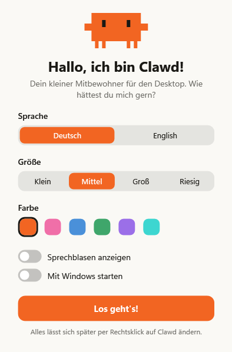

<h1 align="center">Clawd Desktop Pet</h1>

<p align="center">
  <a href="README.md">English</a> · <b>Deutsch</b>
</p>

<p align="center">
  Ein kleiner Pixel-Mitbewohner, der auf deiner Windows-Taskleiste lebt.<br>
  Er läuft herum, schläft, trinkt Kaffee – und tippt mit, wenn du tippst.
</p>

<p align="center">
  
</p>

> **Inoffizielles Fan-Projekt.** Dieses Projekt steht in keiner Verbindung zu Anthropic und wird nicht von Anthropic unterstützt. „Claude“ und das Clawd-Maskottchen gehören Anthropic.

## Was er kann

**Er beschäftigt sich selbst**

- Spaziert über die Taskleiste, hüpft, tanzt, winkt und streckt sich
- Schläft (nachts öfter), trinkt Kaffee, liest ein Buch, setzt die Sonnenbrille auf
- Folgt deinem Mauszeiger mit den Augen und blinzelt
- **Landet auf deinen Fenstern:** Lass ihn auf ein Fenster fallen oder wirf ihn drauf – er steht und läuft auf der Oberkante und fällt runter, wenn du das Fenster wegziehst

**Er reagiert auf dich**

- **Du tippst → er tippt.** Clawd holt einen Laptop raus und drückt für jeden deiner Tastendrücke eine Taste
- **Du bist 2 Minuten weg → er schläft ein**
- **Du kommst zurück → er wacht auf und winkt**
- **Es läuft Ton → er tanzt**, und zwar umso wilder, je lauter es ist

**Er wächst mit dir**

- **Hunger:** Mit der Zeit bekommt er Hunger und zeigt eine kleine Keks-Blase, wenn er Futter will
- **Level:** Füttern und Streicheln geben XP. Neue Level schalten Tricks (Salto, Jonglieren, Ballonfahrt, Wand hochklettern), Farben und Outfits frei
- **Outfits:** Mütze, Partyhut, Kopfhörer, Zylinder und Krone, auswählbar im Rechtsklick-Menü

**Du kannst mit ihm spielen**

| Aktion | Was passiert |
| --- | --- |
| Klick | Streicheln (Herzchen!) – oder aufwecken |
| Doppelklick | Salto |
| Ziehen und loslassen | Hochheben und werfen – er prallt ab und wird nach hartem Aufprall schwindelig |
| Rechtsklick | Menü: Level und Hunger, Füttern, Aktivitäten, Outfit, Farbe, Größe, Sprache, Sprechblasen, zu Musik tanzen, Autostart |
| Symbol neben der Uhr | Zeigen / Verstecken, zurück in die Mitte, Beenden |

Im Rechtsklick-Menü warten noch mehr Tricks – manche erst, wenn er das passende Level erreicht hat.

## Loslegen

**Download:** `ClawdPet.exe` von der Seite [Releases](../../releases) laden und doppelklicken. Kein Installer, keine Abhängigkeiten – es ist eine einzige kleine Datei.

Beim ersten Start fragt ein Willkommensfenster nach **Sprache (Deutsch / English)**, Größe und Farbe:

<p align="center">
  
</p>

Alles lässt sich später per Rechtsklick auf Clawd ändern.

> Windows SmartScreen warnt eventuell vor einem unbekannten Herausgeber, weil die Datei nicht signiert ist. Wähle „Weitere Informationen“ → „Trotzdem ausführen“ oder baue die App selbst aus dem Quellcode.

## macOS

Es gibt auch eine Mac-Version, geschrieben in Swift (Ordner [`mac`](mac)). Sie braucht macOS 12 oder neuer und läuft auf Apple-Chips und Intel.

**Download:** [ClawdPet-mac.zip](../../raw/mac-ci/ClawdPet-mac.zip) – immer der neueste automatische Bau. Entpacken und `ClawdPet.app` an einen beliebigen Ort legen.

Die App ist nicht mit einem bezahlten Apple-Entwicklerkonto signiert, deshalb blockiert macOS den ersten Start. Rechtsklick auf die App → **Öffnen** → **Öffnen**. Auf neueren macOS-Versionen: einmal versuchen zu öffnen, dann Systemeinstellungen → Datenschutz & Sicherheit → **Dennoch öffnen**.

Was auf dem Mac anders ist:

- Clawd steht auf dem Dock und hat ein Symbol in der Menüleiste statt neben der Uhr
- Menüs und Willkommensfenster nutzen das normale macOS-Aussehen
- Kein Tanzen zu Musik (macOS gibt den Lautsprecherpegel nicht heraus)
- Alles andere ist gleich: Fenster als Plattformen, Mittippen, Hunger, Level, Outfits, Demo-Modus

Selbst bauen auf einem Mac mit den Xcode-Kommandozeilenwerkzeugen: `bash mac/build.sh`

> Die Mac-Version wird automatisch auf Macs von GitHub gebaut und gestartet, das Ergebnis wird anhand von Bildschirmfotos geprüft. Klicken, Ziehen und Werfen hat auf einem echten Mac noch kein Mensch ausprobiert – Rückmeldungen sind willkommen.

## Selbst bauen

Es muss nichts installiert werden – das Skript nutzt den C#-Compiler, der in Windows enthalten ist (.NET Framework 4.x):

```powershell
powershell -ExecutionPolicy Bypass -File build.ps1
.\ClawdPet.exe
```

Die ganze App steckt in einer Datei: [`ClawdPet.cs`](ClawdPet.cs).

## Demo-Modus

Du willst ein Video aufnehmen? Rechtsklick auf Clawd → **Demo-Modus** (oder Start mit `ClawdPet.exe --demo`). Dann spielt er alle 17 Aktivitäten nacheinander in fester Reihenfolge ab, jeweils ein paar Sekunden, und ignoriert dabei deine Tastatur.

## Datenschutz

Zum Mittippen fragt die App Windows, *ob* gerade eine Taste gedrückt ist (`GetAsyncKeyState`). *Welche* Taste es ist, wird nie ausgewertet, und nichts wird gespeichert oder gesendet – die App nutzt das Netzwerk überhaupt nicht. Manche Virenscanner stufen so eine Abfrage trotzdem als verdächtig ein.

Fürs Tanzen liest die App, wie laut deine Lautsprecher gerade sind – nur den Pegel, es wird kein Ton aufgenommen. Um auf Fenstern zu stehen, liest sie die Position deiner offenen Fenster, nicht deren Inhalt.

Das Rechtsklick-Menü hat einen Milchglas-Look. Dafür nimmt die App beim Öffnen ein Bild des kleinen Bildschirmbereichs hinter dem Menü auf und zeichnet es weich. Das Bild liegt nur im Arbeitsspeicher, solange das Menü offen ist.

Einstellungen und Fortschritt liegen in `%AppData%\ClawdPet\settings.txt`.

## Gut zu wissen

- Windows 10 / 11
- Clawd bleibt auf dem Hauptmonitor
- Braucht im Betrieb ein paar Prozent eines CPU-Kerns

## Mitmachen

Ideen, Fehlerberichte und Pull Requests sind willkommen – besonders neue Aktivitäten und weitere Sprachen.

## Lizenz

[MIT](LICENSE) für den Code. Die Figur Clawd und der Name Claude bleiben Eigentum von Anthropic.
