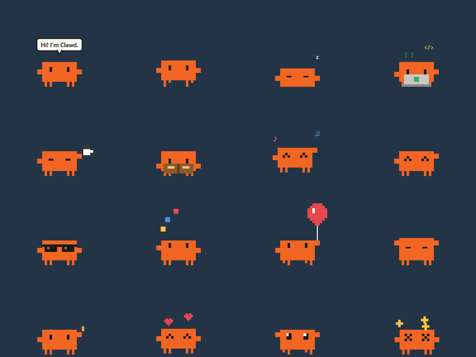
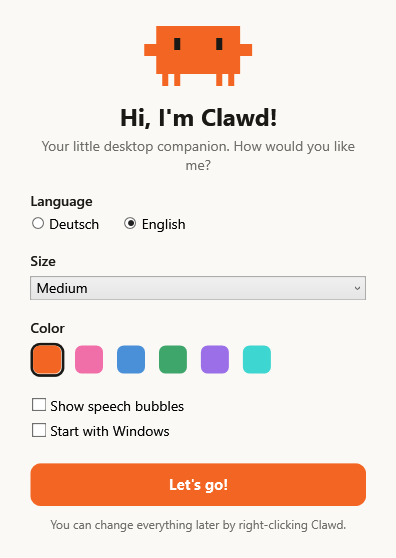

<h1 align="center">Clawd Desktop Pet</h1>

<p align="center">
  <b>English</b> · <a href="README.de.md">Deutsch</a>
</p>

<p align="center">
  A tiny pixel companion that lives on your Windows taskbar.<br>
  He wanders around, naps, drinks coffee – and types along whenever you type.
</p>

<p align="center">
  
</p>

> **Unofficial fan project.** Not affiliated with, endorsed by, or supported by Anthropic. "Claude" and the Clawd mascot belong to Anthropic.

## Features

**He keeps himself busy**

- Walks along the taskbar, hops, dances, waves and stretches
- Naps (more often at night), drinks coffee, reads a book, puts on sunglasses
- Follows your mouse pointer with his eyes and blinks

**He reacts to you**

- **You type → he types.** Clawd pulls out a laptop and taps a key for every key you press
- **You're away for 2 minutes → he falls asleep**
- **You come back → he wakes up and waves**

**You can play with him**

| Action | What happens |
| --- | --- |
| Click | Pet him (hearts!) – or wake him up |
| Double-click | Flip |
| Drag and release | Pick him up and throw him – he bounces, and gets dizzy after a hard landing |
| Right-click | Menu: feed, more activities, size, color, language, speech bubbles, start with Windows |
| Tray icon | Show / hide, bring him back to the centre, quit |

More tricks are waiting in the right-click menu: juggling, a balloon ride, climbing the edge of the screen, chasing the mouse.

## Getting started

**Download:** grab `ClawdPet.exe` from the [Releases](../../releases) page and double-click it. No installer, no dependencies – it is a single small file.

On first launch a welcome window lets you pick the **language (English / Deutsch)**, size and color:

<p align="center">
  
</p>

Everything can be changed later by right-clicking Clawd.

> Windows SmartScreen may warn about an unknown publisher, because the file is not code-signed. Choose "More info" → "Run anyway", or build it yourself from source.

## Build from source

Nothing to install – the script uses the C# compiler that ships with Windows (.NET Framework 4.x):

```powershell
powershell -ExecutionPolicy Bypass -File build.ps1
.\ClawdPet.exe
```

The whole app is one file, [`ClawdPet.cs`](ClawdPet.cs).

## Privacy

To type along, the app asks Windows *whether* a key is currently pressed (`GetAsyncKeyState`). It never looks at *which* key, and nothing is stored or sent anywhere – the app does not use the network at all. Some antivirus tools flag this kind of check anyway.

Settings live in `%AppData%\ClawdPet\settings.txt`.

## Good to know

- Windows 10 / 11
- Clawd stays on the primary monitor
- Uses a few percent of one CPU core while running

## Contributing

Ideas, bug reports and pull requests are welcome – new activities and more languages especially.

## License

[MIT](LICENSE) for the code. The Clawd character and the Claude name remain the property of Anthropic.
